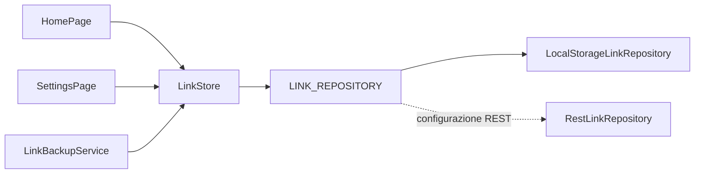
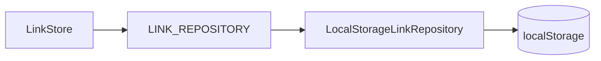
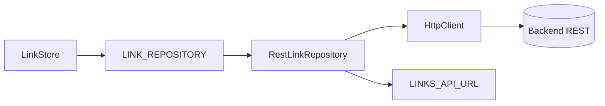
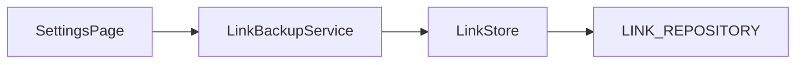
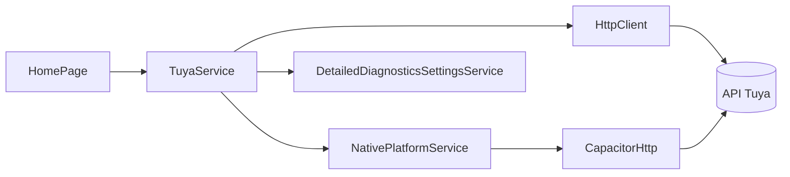
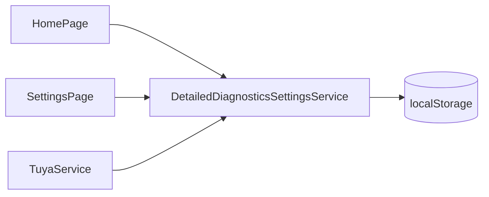
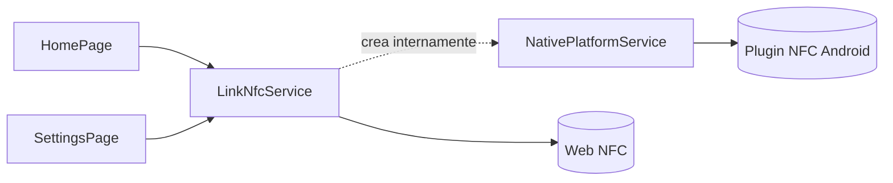
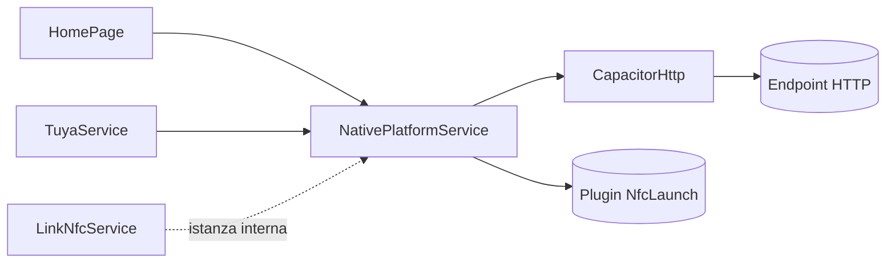

# Consumer e dipendenze dei servizi

Le frecce indicano chi utilizza chi. I consumer elencati sono quelli del codice applicativo; i provider esterni indicano API o funzionalità della piattaforma.

## `LinkStore`

Gestisce lo stato condiviso dei link e ne coordina caricamento e persistenza. È usato dalla home, dalla configurazione e dal servizio di backup.

`LINK_REPOSITORY` usa `LocalStorageLinkRepository` per impostazione predefinita. `main.ts` seleziona `RestLinkRepository` e configura `LINKS_API_URL` quando `environment.linkPersistence` vale `rest`.

## `LocalStorageLinkRepository`

Implementazione predefinita di `LinkRepository`, selezionata dal token `LINK_REPOSITORY`.

## `RestLinkRepository`

Implementazione REST di `LinkRepository`, selezionata in `main.ts` quando la persistenza configurata è `rest`.

## `LinkBackupService`

Crea, valida e importa/esporta i backup dei link. La pagina Configurazione ne avvia le operazioni; il servizio legge e aggiorna la raccolta tramite lo store.

## `TuyaService`

Esegue autenticazione e invio dei comandi Tuya. La HomePage lo usa per i link di tipo Tuya.

Su Android usa `CapacitorHttp`; negli altri ambienti usa `HttpClient`.

## `DetailedDiagnosticsSettingsService`

Espone e persiste in `localStorage` la preferenza per la diagnostica dettagliata.

## `LinkNfcService`

Gestisce associazione e scansione dei tag NFC. La HomePage avvia la scansione e la pagina Configurazione associa un tag a un link.

La scrittura usa il percorso nativo nell'app Android e Web NFC nel browser; nell'app Android la lettura dei tag viene gestita automaticamente dal servizio nativo.

## `NativePlatformService`

Fornisce le operazioni NFC e HTTP native Android. È iniettato direttamente dalla HomePage e da `TuyaService`; `LinkNfcService` ne crea anche un'istanza internamente per la scrittura NFC.

L'endpoint HTTP è il server del link o l'API Tuya, a seconda del consumer che effettua la richiesta.
