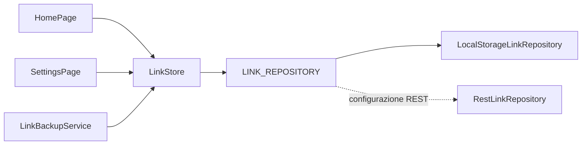
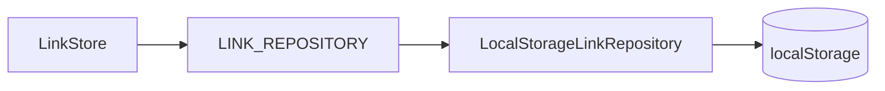
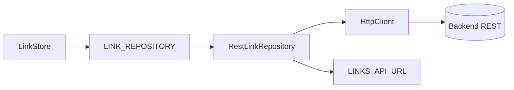
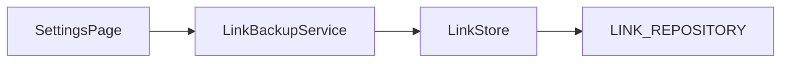
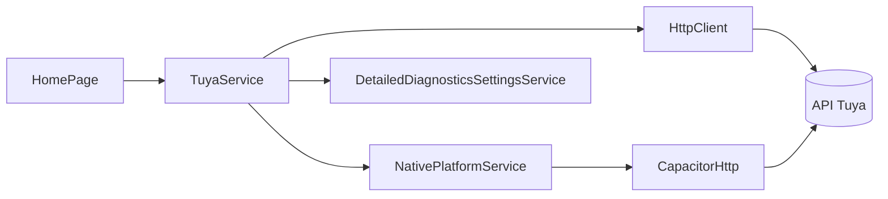
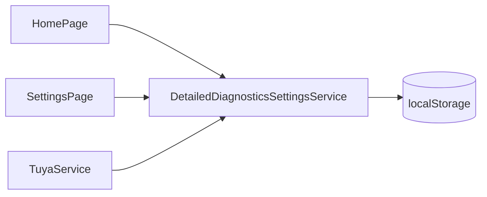
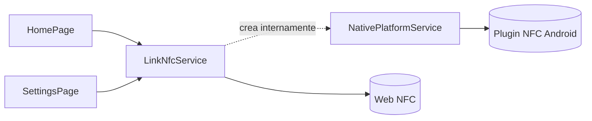
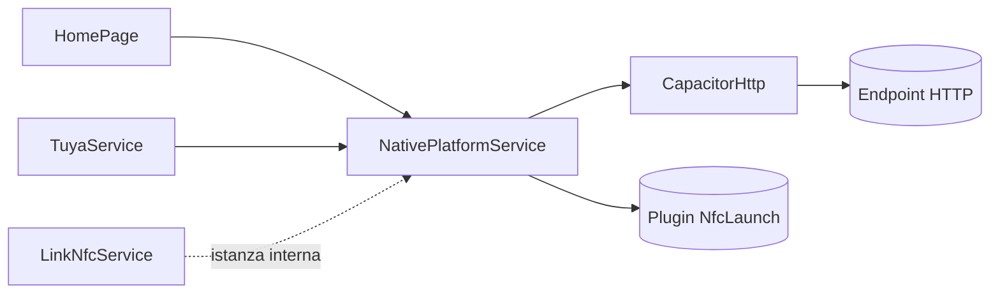

# Consumer e dipendenze dei servizi

Le frecce indicano chi utilizza chi. I consumer elencati sono quelli del codice applicativo; i provider esterni indicano API o funzionalità della piattaforma.

## `LinkStore`

Gestisce lo stato condiviso dei link e ne coordina caricamento e persistenza. È usato dalla home, dalla configurazione e dal servizio di backup.

`LINK_REPOSITORY` usa `LocalStorageLinkRepository` per impostazione predefinita. `main.ts` seleziona `RestLinkRepository` e configura `LINKS_API_URL` quando `environment.linkPersistence` vale `rest`.

**Perché i consumer dipendono da `LinkStore`**

- **`HomePage`** dipende dallo store per ottenere la raccolta iniziale, filtrare i link visibili, mostrare lo stato di caricamento/persistenza e applicare riordinamenti senza accedere direttamente alla sorgente di dati.
- **`SettingsPage`** dipende dallo store per creare, modificare e rimuovere i link, mantenendo sincronizzate le informazioni condivise con la HomePage.
- **`LinkBackupService`** dipende dallo store per esportare lo stato corrente dei link e sostituirlo durante un'importazione.
- **`LinkStore`** dipende da `LINK_REPOSITORY` perché non implementa direttamente né `localStorage` né il backend REST: delega a tale astrazione le operazioni di caricamento e salvataggio.

## `LocalStorageLinkRepository`

Implementazione predefinita di `LinkRepository`, selezionata dal token `LINK_REPOSITORY`.

**Perché i consumer dipendono da `LocalStorageLinkRepository`**

- **`LinkStore`** dipende da questa implementazione attraverso `LINK_REPOSITORY` per leggere i link all'avvio e salvarne ogni modifica in modo persistente sul dispositivo.
- **`LocalStorageLinkRepository`** dipende da `localStorage` perché è responsabile della serializzazione fisica dei link nella chiave dell'applicazione, consentendo al resto dell'applicazione di ignorare questo dettaglio browser.

## `RestLinkRepository`

Implementazione REST di `LinkRepository`, selezionata in `main.ts` quando la persistenza configurata è `rest`.

**Perché i consumer dipendono da `RestLinkRepository`**

- **`LinkStore`** dipende da questa implementazione quando `main.ts` configura il provider REST: ottiene così caricamento e salvataggio centralizzati su un server condiviso invece che in `localStorage`.
- **`RestLinkRepository`** dipende da `HttpClient` per eseguire le chiamate HTTP verso il backend e da `LINKS_API_URL` per conoscere l'indirizzo configurato dei link.
- **`HttpClient`** dipende dal `Backend REST` come canale verso la sorgente remota che risponde alle operazioni `GET` e `PUT`.

## `LinkBackupService`

Crea, valida e importa/esporta i backup dei link. La pagina Configurazione ne avvia le operazioni; il servizio legge e aggiorna la raccolta tramite lo store.

**Perché i consumer dipendono da `LinkBackupService`**

- **`SettingsPage`** dipende dal servizio per creare il contenuto JSON esportabile, convalidare un file importato e applicare un'importazione in modalità merge o replace, senza duplicare queste responsabilità nella pagina.
- **`LinkBackupService`** dipende da `LinkStore` perché la raccolta da esportare è lo stato condiviso dell'applicazione e l'importazione deve aggiornare la stessa sorgente utilizzata da HomePage e SettingsPage.

## `TuyaService`

Esegue autenticazione e invio dei comandi Tuya. La HomePage lo usa per i link di tipo Tuya.

Su Android usa `CapacitorHttp`; negli altri ambienti usa `HttpClient`.

**Perché i consumer dipendono da `TuyaService`**

- **`HomePage`** dipende dal servizio per autenticarsi presso Tuya, firmare il comando, inviarlo al dispositivo configurato e presentare un'esito uniforme senza conoscere i dettagli del protocollo HMAC-SHA256 e delle due richieste HTTP.
- **`TuyaService`** dipende da `HttpClient` oppure da `NativePlatformService` perché deve trasportare la richiesta rispettivamente nell'ambiente web o nell'app Android.
- **`TuyaService`** dipende da `DetailedDiagnosticsSettingsService` per decidere se registrare i dettagli delle richieste e delle risposte, che possono essere mostrati dalla HomePage in caso di successo o errore.
- **`HttpClient`** e **`CapacitorHttp`** dipendono dall'`API Tuya` come destinazione esterna delle richieste di token e dei comandi.

## `DetailedDiagnosticsSettingsService`

Espone e persiste in `localStorage` la preferenza per la diagnostica dettagliata.

**Perché i consumer dipendono da `DetailedDiagnosticsSettingsService`**

- **`HomePage`** dipende dal servizio per leggere l'impostazione corrente e includere o escludere i dettagli diagnostici nelle chiamate HTTP/Tuya, oltre a esporre lo stato reattivo alla UI.
- **`SettingsPage`** dipende dal servizio per mostrare la preferenza, modificarla dall'interruttore e informare l'utente se il browser non è riuscito a persistere il valore.
- **`TuyaService`** dipende dal servizio per decidere se inizializzare la raccolta diagnostica e restituirla dentro `TuyaRequestError` o nel risultato dell'esecuzione.
- **`DetailedDiagnosticsSettingsService`** dipende da `localStorage` per conservare la scelta tra le sessioni e leggere il valore legacy precedente, mantenendo compatibile la migrazione dell'impostazione.

## `LinkNfcService`

Gestisce associazione e scansione dei tag NFC. La HomePage avvia la scansione e la pagina Configurazione associa un tag a un link.

La scrittura usa il percorso nativo nell'app Android e Web NFC nel browser; nell'app Android la lettura dei tag viene gestita automaticamente dal servizio nativo.

**Perché i consumer dipendono da `LinkNfcService`**

- **`HomePage`** dipende dal servizio per avviare o arrestare la scansione Web NFC, elaborare i tag letti e mostrare messaggi o stati di errore coerenti.
- **`SettingsPage`** dipende dal servizio per associare l'ID di un link a un tag, delegando la scelta tra Web NFC e implementazione Android.
- **`LinkNfcService`** dipende da `NativePlatformService` nell'app Android per individuare il percorso nativo e scrivere un tag; nel browser dipende da `Web NFC` perché usa `NDEFReader` per scansione e associazione.
- **`NativePlatformService`** dipende dal `Plugin NFC Android` per accedere alle API native di disponibilità, ascolto dei tag, scrittura e annullamento.

## `NativePlatformService`

Fornisce le operazioni NFC e HTTP native Android. È iniettato direttamente dalla HomePage e da `TuyaService`; `LinkNfcService` ne crea anche un'istanza internamente per la scrittura NFC.

L'endpoint HTTP è il server del link o l'API Tuya, a seconda del consumer che effettua la richiesta.

**Perché i consumer dipendono da `NativePlatformService`**

- **`HomePage`** dipende dal servizio per distinguere l'app Android dal browser, inviare richieste HTTP native evitando il comportamento CORS, avviare l'ascolto dei tag e verificare la disponibilità NFC.
- **`TuyaService`** dipende dal servizio per eseguire le richieste di autenticazione e comando tramite `CapacitorHttp` quando l'app gira su Android.
- **`LinkNfcService`** crea internamente `NativePlatformService` per verificare se è in un'app Android e usare la scrittura NFC nativa invece di Web NFC.
- **`NativePlatformService`** dipende da `CapacitorHttp` per inoltrare richieste HTTP generiche o Tuya verso endpoint esterni e da `NfcLaunchPlugin` per eseguire le operazioni NFC native.
